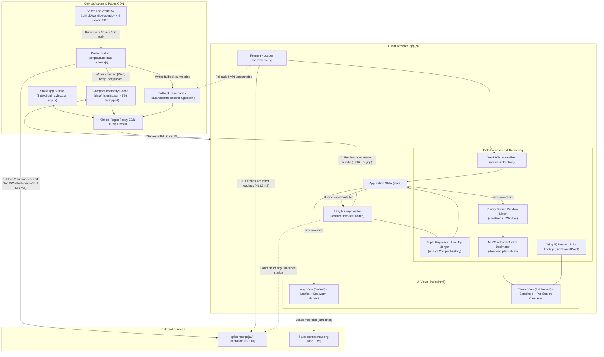

# Sensoripaja — Water Temperature Telemetry (`uimari.github.io`)

Minimalist dark-mode web application visualizing live and historical water temperature sensor data from [`api.sensoripaja.fi`](https://api.sensoripaja.fi) (`swimhelsinki` & `swimespoo`), deployed at [`https://uimari.github.io/`](https://uimari.github.io/).

---

## System Architecture & Component Diagram



---

## End-to-End Data Flow (Sequence Diagram)

```mermaid
sequenceDiagram
    autonumber
    actor User
    participant Browser as Browser (app.js)
    participant CDN as GitHub Pages CDN
    participant API as api.sensoripaja.fi
    participant OSM as OpenStreetMap Tiles
    participant Action as GitHub Actions (Cron 30m)

    rect rgb(30, 41, 59)
        Note over Action,CDN: Background Cache Refresh (Every 30 Minutes)
        Action->>API: Fetch 2 featurecollection.geojson + 34 <station>.geojson (~14.2 MB)
        API-->>Action: Raw GeoJSON telemetry
        Action->>Action: Run scripts/build-data-cache.mjs (sort, dedupe, compact to [tSec, temp, batt])
        Action->>CDN: Deploy artifact with data/histories.json (~2.96 MB raw / ~796 KB gzip)
    end

    rect rgb(15, 23, 42)
        Note over User,OSM: Initial Page Load (Default: Map View)
        User->>CDN: Open https://uimari.github.io/
        CDN-->>Browser: index.html, styles.css, app.js
        Browser->>API: Fetch swimhelsinki & swimespoo featurecollection.geojson (~13.5 KB total)
        alt API reachable
            API-->>Browser: Latest station temperatures, coordinates, battery, timestamps
        else API unreachable
            Browser->>CDN: Fallback to ./data/*/featurecollection.geojson
            CDN-->>Browser: Cached station summaries
        end
        Browser->>Browser: normalizeFeature() & compute coolwarm [minTemp, maxTemp]
        Browser->>OSM: Request visible map tiles
        OSM-->>Browser: Map tiles (styled with dark CSS filter)
        Browser-->>User: Render interactive Map with coolwarm pill markers & legend
    end

    rect rgb(30, 27, 75)
        Note over User,API: Switching to Charts View (Lazy-Loaded Time Series)
        User->>Browser: Click "Charts" tab (default range: 3M)
        Browser->>CDN: Fetch ./data/histories.json (gzipped)
        CDN-->>Browser: Compact histories for all 34 stations (~796 KB)
        Browser->>Browser: unpackCompactHistory() + append newer live reading from featurecollection
        opt Station missing from cache
            Browser->>API: Fetch missing <station>.geojson
            API-->>Browser: Station GeoJSON history
        end
        Browser->>Browser: slicePointsInWindow() -> downsampleMinMax()
        Browser-->>User: Render Combined Multi-Sensor Chart + 34 Per-Station Cards
    end
```



---

## Client Rendering & State Pipeline

```mermaid
flowchart LR
    subgraph Input["User Controls"]
        Tab["View Switcher (Map | Charts)"]
        Region["Region Filter (All | Helsinki | Espoo)"]
        Range["Time Range (1W | 1M | 3M | 6M | YTD | 1Y | 2Y | All)"]
        Search["Station Search & Sort"]
        Storage["Hide Winter Storage Toggle"]
    end

    subgraph Filter["Station Filtering (getVisibleStations)"]
        Vis["Filtered & Sorted Stations"]
    end

    subgraph MapPipeline["Map Rendering (renderMapView)"]
        CW["Coolwarm Colormap (coolwarmColor)"]
        Markers["Leaflet DivIcon Pill Markers & Popups"]
        LegendBar["Dynamic Min / Mid / Max Legend Bar"]
    end

    subgraph ChartPipeline["Chart Rendering (renderOverviewChart & renderStationChart)"]
        Win["Active Time Window (getActiveWindow)"]
        BinSlice["O(log N) Window Slice (slicePointsInWindow)"]
        Decimate["Pixel-Bucket Min/Max Downsampling (downsampleMinMax)"]
        YBounds["Tight Y-Axis Bounds (computeTightYBounds - 1.5% margin)"]
        Canvas["High-DPI HTML5 Canvas Draw"]
    end

    Input --> Vis
    Vis -->|"state.view === map"| CW --> Markers --> LegendBar
    Vis -->|"state.view === charts"| Win --> BinSlice --> Decimate --> YBounds --> Canvas
```



---

## Component Reference

| File | Responsibility |
| :--- | :--- |
| [`index.html`](./index.html) | App shell, top control bar (Map/Charts tabs, region filter, 3M-default time range picker, search, sort), Map container + coolwarm legend, Combined chart section, and station card container. |
| [`styles.css`](./styles.css) | Dark-mode UI styling, responsive layout (`Stacked` and `Grid` modes), Leaflet dark-tile CSS filter, and coolwarm legend bar styling. |
| [`app.js`](./app.js) | State management, live summary loader (`loadTelemetry`), lazy history loader (`ensureHistoriesLoaded`), Leaflet map integration, `<canvas>` time-series engine, binary-search slicing/hover, and min/max pixel-bucket downsampling. |
| [`scripts/build-data-cache.mjs`](./scripts/build-data-cache.mjs) | Node.js build script that fetches all 34 station `.geojson` histories from `api.sensoripaja.fi` and compacts them into `./data/histories.json`. |
| [`.github/workflows/deploy.yml`](./.github/workflows/deploy.yml) | GitHub Actions workflow running every 30 minutes (`cron: "*/30 * * * *"`) and on `push` to `main` to refresh `./data/histories.json` and publish to GitHub Pages. |

---

## Local Development

```bash
# Optional: refresh local ./data/histories.json cache from api.sensoripaja.fi
node scripts/build-data-cache.mjs

# Start local static HTTP server
python3 -m http.server 8080
```

Then open `http://localhost:8080`.
